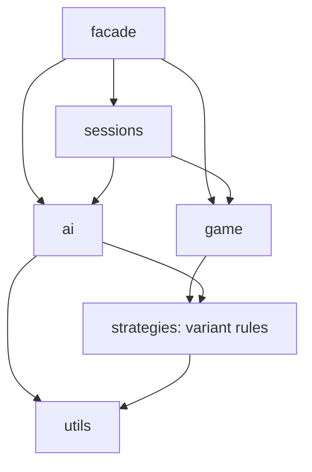
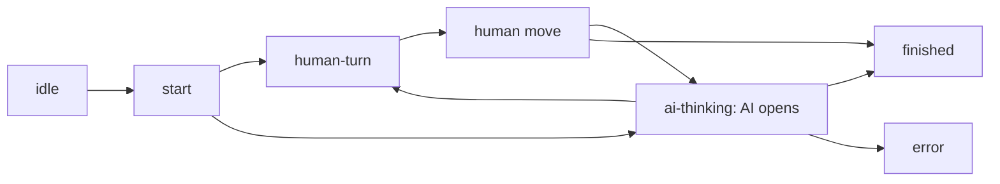
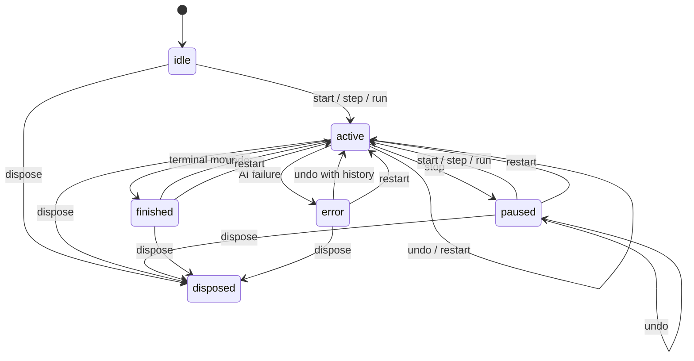
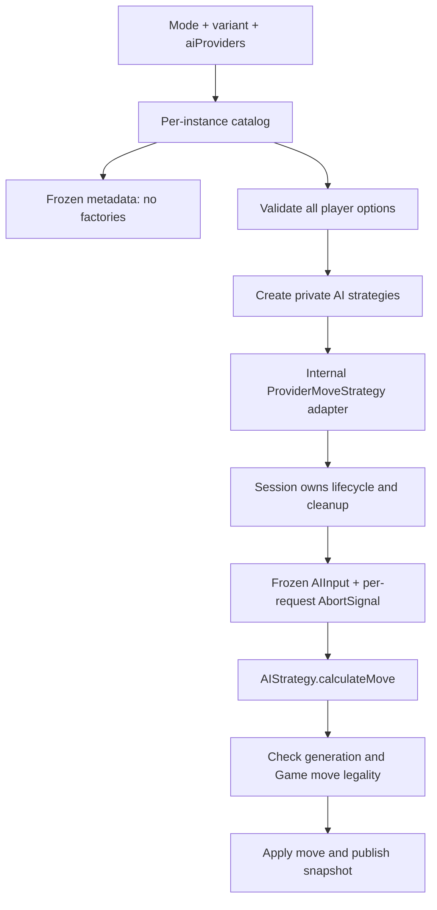

# Architecture

`t3core` is a framework-independent TypeScript library for Tic Tac Toe. It
provides game rules and history, AI move selection, session orchestration,
and a typed facade. React integration lives in the [README](README.md);
the runtime library has no React dependency.

## Public API and internal modules

The public API is the set of values and types re-exported by
[`src/index.ts`](src/index.ts). Consumers import from `t3core`. Its only runtime exports are `TicTacToe` and
`AIProviderError`; other exports are types.
[`package.json`](package.json) exposes the package root and `t3core/package.json`;
source paths and internal barrels are not supported package subpaths.
An `export` inside an implementation file does not by itself make a symbol
public to npm consumers.

The [README](README.md) describes public usage and action outcomes; the
[provider guide](docs/ai-providers.md) covers custom AI engines. The
[migration notes](docs/v2-migration.md) describe breaking API changes.
The descriptions below cover the current working branch; the package version
is unchanged.

| Module | Responsibility | Boundary |
| --- | --- | --- |
| [`game`](src/game/Game.ts) | Owns board state, player turns, status, history, and synchronous state notifications. | `Game` and `Board` are internal; immutable domain data types are public. |
| [`strategies`](src/strategies/strategies.types.ts) | Defines variant metadata, move legality, legal indices and status evaluation for live and simulated positions. | Read-only `GameRules` is public; `GameStrategy` and variant resolution are internal. Only classic 3×3 is supported. |
| [`ai`](src/ai/providers/types.ts) | Chooses moves; defines provider validation, factories, cancellation and cleanup contracts. Includes alpha-beta, random selection, and seeded RNG. | Public `AIProvider` creates private `AIStrategy` instances. `MoveStrategy`, engine classes, search helpers and adapters are internal. |
| [`sessions`](src/sessions/BaseSession.ts) | Coordinates `Game`, human input, AI, lifecycle, events, and stale operations. | All session classes are internal; facade instance, event, result and snapshot contracts are public. |
| [`facade`](src/facade/TicTacToe.ts) | Validates mode/configuration, resolves per-instance provider catalogs, constructs sessions and exposes capability metadata. | `TicTacToe` exposes mode-specific facades and static `getCapabilities`. Wrappers, catalog and construction helpers are internal. |
| [`utils`](src/utils/getWinnerFromFields.ts), [`constants`](src/constants/gameConstants.ts) | Shared winner detection and default symbols. | Implementations and constants remain internal. |

### Contract ownership

| File | Responsibility |
| --- | --- |
| [game/contracts.ts](src/game/contracts.ts) | Fixed O/X symbols, immutable position types, implemented variant metadata, and running/terminal results. |
| [sessions/state/types.ts](src/sessions/state/types.ts) | Mode-aware session snapshots and valid phase/result/input combinations. |
| [sessions/results.ts](src/sessions/results.ts) | Action results, method-specific refusals, and serializable AI errors. |
| [facade/options.ts](src/facade/options.ts) | Mode-specific configuration with options tied to registered AI engine IDs. |
| [facade/types.ts](src/facade/types.ts) | Runtime per-mode instances, generic constructor and static discovery. |
| [ai/providers/types.ts](src/ai/providers/types.ts) | Provider metadata, normalized option validation, private factories and cancellable strategies. |
| [facade/catalog/types.ts](src/facade/catalog/types.ts) | Read-only capability discovery inputs and outputs. |
| [strategies/strategies.types.ts](src/strategies/strategies.types.ts) | Public simulation rules and internal variant strategy contract. |

## Dependency direction

The main implementation dependencies are shown below. Shared contracts and
defaults are omitted; AI reads game types without owning or mutating a `Game`.

The facade constructs either a human-driven wrapper or an AI-vs-AI wrapper
([instances.ts](src/facade/instances.ts)), so unsupported mode methods are absent
at runtime as well as in types. Common observation/lifecycle delegation is shared.
The overloaded constructor type is attached at a single documented TypeScript
boundary; source and installed-consumer tests check its mode-specific guarantees.
The constructor returns a concrete facade object; consumers identify its mode
through `mode`, not class identity.

Keep orchestration in sessions and construction in the facade. The game
layer must remain usable without AI or sessions. AI strategies receive
read-only data rather than a mutable game or a UI callback. Variant rules
must stay independent of session lifecycle. Shared contracts live with
their owning module; avoid importing the public root barrel back into
implementation modules and introducing dependency cycles.

The canonical [domain contracts](src/game/contracts.ts) define fixed O/X symbols,
board cells and immutable running/terminal results. Internal leaf type files
re-export these definitions; public providers and snapshots use the same types.

`GameStrategy` describes a variant and evaluates legality and status without
owning mutable state. Game delegates both human and AI validation to these rules.
Providers receive the same stateless rules for simulation and choose a move.
Adding a board variant requires updating the
game variant registry and its tests; alpha-beta currently validates a
nine-cell board and cannot automatically support another variant.

## State, snapshots, and history

[`Board`](src/game/Board.ts) owns mutable storage. Empty fields contain
numeric labels; occupied fields contain string player symbols. Operations
use zero-based indices. The default symbols are `O` and `X`, with `O` starting.

The exposed `BoardSnapshot` is a cached, shallow-frozen copy. Repeated reads
return the same array until a board mutation, history restore, or reset.
Writing a field records a new history array. `backToMove(index)` restores
an existing history entry; making a subsequent move truncates its future.
`movesCount` counts recorded moves, so restoring history alone does not
truncate that count.

`Game.snapshot` caches `{ board, currentPlayer, gameStatus }`. Its reference
remains stable between accepted state operations and changes after a
successful `savePlayerMove`, successful `backToMove`, or `reset`. Rejected
moves do not replace it. Its board array is always frozen at runtime. The
low-level snapshot wrapper is not frozen, and status freezing is not a general
low-level guarantee; treat the surrounding objects as read-only too.

Sessions own a separate [SessionStore](src/sessions/state/SessionStore.ts).
`snapshot` and stable bound `getSnapshot()` return the same full session state:
board, resolved variant, mode, human symbol, current player, result, phase,
input availability, legal moves, current move count, undo availability and error.
The entire snapshot, including nested arrays and metadata, is frozen.
Repeated reads reuse its reference. A phase-only change reuses the board and
legal-moves array. Session `movesCount` counts occupied fields in the current
position; it does not count retained future history.

Snapshot types encode valid phase/result/input combinations. Narrowing on
`phase` determines input availability and the result: `finished` has a terminal
result and disables play, while `error` carries an AI error and a running
position. PvP cannot enter AI phases; AI-vs-AI cannot enter `human-turn`.
Disposed snapshots preserve the previous result/error but disable play and undo.

Types cannot prove board length, numeric bounds, occupancy, turn ownership or
consistency between the board and its result. Runtime rules validate moves;
the session boundary validates O/X data and freezes the complete snapshot.
Reference stability, notification ordering and independent subscription cleanup
are runtime guarantees verified by tests, rather than by types alone.

The store attaches no listeners to Game. Sessions commit state after their
domain mutations and Game callbacks return. Direct constructors accept a
pre-populated Game, but subsequent mutations must go through the session.
External writes to an injected Game bypass coherent session observation.

Board accessors throw `RangeError` for invalid indices. `Game.savePlayerMove`
and `Game.backToMove` instead return their documented status values for
invalid input. `Game.isFieldSelectedByIndex` delegates to the board and can
throw. Keep these contracts distinct when changing validation.

## Notifications and event ordering

There are three notification surfaces:

| Surface | Payload | When it notifies |
| --- | --- | --- |
| `Game.on(GameEvent.STATE_CHANGE, handler)` | `GameEventPayload`: `{ board, currentPlayer, gameStatus }` | Synchronously after an accepted move, history restore, or reset has updated the snapshot. |
| Session/facade `subscribe(callback)` | No arguments; read `getSnapshot()` in the callback. | After session moves, phase changes, errors and reset, in every mode. |
| Session/facade `on(event, handler)` | Typed gameplay payload from `GameSessionEventPayload`. | During session operations, as described below. |

`subscribe` and `getSnapshot` are stable, bound functions. Registration does not
notify immediately. A phase change can notify without changing the board.
Each subscription has its own idempotent cleanup, even when the same callback is registered
twice. For `on`/`off`, remove a listener with the same handler reference.

Session events carry these payloads, without a `type` field:

| Event | Payload | Meaning |
| --- | --- | --- |
| `move` | `{ player, position }` | A move has been applied. |
| `turn` | `{ player }` | Control passes to the next player; human-driven `start()` also announces the opening human turn. |
| `ai-thinking` | `{ player }` | An AI calculation is about to start. |
| `finished` | `{ result }` | The session reached a win or draw. |

When callbacks do not invalidate the operation or throw, an accepted move updates
Game and emits `STATE_CHANGE`. The session then commits its full snapshot and
notifies session/facade subscribers before emitting `move`. A terminal move
is followed by `finished`.
A nonterminal PvP or AI move is followed by `turn`. A nonterminal human move
in single-player instead starts `ai-thinking` and the AI calculation; the
AI's reply then emits its own `move` and `turn` or `finished`. Subscribers
observe both board snapshots separately. If the human ends the game, there
is no AI reply.

An opening AI turn publishes `ai-thinking` before its event and calculation.
A human move commits the board together with `ai-thinking`; the reply commits
`human-turn` or `finished`. AI-vs-AI `step` commits `ai-ready` after a nonterminal
move, while `run` stays in `ai-thinking` between moves. The terminal snapshot
is published once. Reads and rejected/busy actions do not notify.

The diagram shows the main single-player turn. Stop enters `paused`; start
resumes it. Restart resets and starts a human-driven game, or returns AI-vs-AI
to `ai-ready`. Undo restores a decision without triggering AI. Dispose is final.

Here `active` groups human turns, AI calculation and AI-vs-AI readiness.
For AI-vs-AI, restart/undo stop at readiness rather than continuing autoplay.
A callback exception can also publish `paused` when it interrupts a move.

Callbacks run synchronously at each emission. Listener exceptions propagate;
they do not roll back an already applied move. A callback can also call
`restart()` or start another operation from a ready-state callback, so session code
checks generation and operation identity after callbacks and awaited work.
A nested publication supersedes the remaining old notification delivery.
Restart publishes the reset position and resumes according to mode. Low-level
Game reset emits only its own domain notification; session observation remains
owned by the session.

## Lifecycle, concurrency, and cancellation

Construction performs no moves and emits no opening events. Register
listeners before starting a session.

| Mode | Entry points | After restart / undo |
| --- | --- | --- |
| `pvp` | `start()`, then `playMove(index)` | Human turn; undo restores one move. |
| `singleplayer` | `start()`, then `playMove(index)`; start/resume calculates an AI turn when needed. | Restart starts automatically; undo restores the last human decision and any AI reply. |
| `aivsai` | `step()` for one move or `run()` to completion. | `ai-ready` without autoplay; undo restores one move. |

[`BaseSession`](src/sessions/BaseSession.ts) owns generation/operation guards,
shared lifecycle actions, snapshot publication and event dispatch. Snapshot
phase is the lifecycle authority; there is no parallel lifecycle enum.
The shared start flow delegates turn resumption to `_resume` (Template Method);
single-player overrides it to calculate AI when appropriate.
[`SessionOperation`](src/sessions/operations/SessionOperation.ts) owns the lock
identity, a cancellation promise and a separate AbortController for each AI
calculation. Variant rules live in strategies; Game owns position and history.

`start` is idempotent on active or finished human-driven sessions. An overlapping
action returns `rejected/busy`. `stop` preserves the position in pause; the
mode's start/step/run resumes it. Stop before start, after completion, in error
or while already paused is a successful no-op. Error state blocks further
start/playMove/step/run until restart or a valid undo.

`restart`, `stop`, valid `undo` and `dispose` invalidate old work before callbacks.
Every asynchronous continuation checks generation and operation identity before
validation or mutation and after helpers/callbacks. Old actions promptly report
`aborted` even if a strategy never resolves. Late rejections are consumed without
changing the current position/error. Only a lock's owner can release it.
A ready-state publication releases its lock before notifying, so a reentrant
action can start immediately; it supersedes the old event/result continuation.

[`getUndoTarget`](src/sessions/state/getUndoTarget.ts) finds the previous decision
using the current number of plies and fixed alternating O/X turns. PvP/AI-vs-AI
undo one ply. Single-player restores the position before the last human move:
one ply if AI has not replied (including a terminal human move), otherwise two.
An AI opening alone has no undo target. The target is a Game history index;
restoring and branching use the existing domain history. Undo clears errors,
preserves pause, emits no new-move/turn events and never starts AI.
A no-history refusal does not cancel work.

`dispose` marks the instance closed before notifications, publishes a final
frozen snapshot preserving board/result/error, and removes all listeners in
cleanup even if a subscriber throws. Owned strategies are disposed once; every
player is cleaned up even if another cleanup fails. The subscriber exception
takes precedence over cleanup exceptions. Later subscriptions are inert. Gameplay
event delivery stops when a listener invalidates the operation or disposes;
remaining listeners do not receive an obsolete event. Repeated disposal is safe.
Session/facade `reset()` has been removed. Use restart for new games; only
internal Game/Board storage retains synchronous reset operations.

[`results`](src/sessions/results.ts) owns the adopted shared action envelope:
`success` with `value`, `rejected` with `reason`, `aborted`, or `error`.
All actions are asynchronous except synchronous stop/undo and void dispose.
Run's success value is a frozen terminal result; repeating run after completion
returns it without new moves or notifications. AI failures return serializable
error data and publish error state. Constructor and application callback errors
still throw without rolling back applied moves; callback errors are not AI errors.

Cancellation combines the logical promise race with a cooperative `AbortSignal`.
Only an active request is aborted; completed requests are detached first. The
generation and lock are invalidated before abort dispatch, and checked again
after it, because an abort listener may synchronously start newer work.
A human move is still refused with `busy` while the snapshot reports
`ai-thinking`, so a listener cannot play the AI's turn before stop publishes
`paused`. Providers stop their own calculations; sessions discard stale answers even when
the signal is ignored. Stop/restart/undo preserve engine resources; disposal
releases them. Neither signals nor promises preempt synchronous JavaScript.
Actual Worker/WASM execution is deferred.

## AI strategy contract

The facade accepts typed per-instance `AIProvider` objects through `aiProviders`.
The selected `engine` determines its option type. A catalog validates metadata,
duplicates, complete variant compatibility and difficulty before calling
`validateOptions(unknown)` for normalized options. Both AI players are validated
before factories run. `create(options)` synchronously returns a fresh private
`AIStrategy`; expensive initialization belongs in its first calculation.
Construction failures clean up any previously created players.

`AIStrategy.calculateMove(input, { signal })` receives frozen board/status/variant
data, fixed O/X symbols and read-only simulation rules, and returns a move index.
It has a required synchronous `dispose()` method. See the
[provider guide](docs/ai-providers.md) for ownership and Worker bridge constraints.
`TicTacToe.getCapabilities` exposes only frozen metadata; it never validates
player options or invokes factories. Its default is alpha-beta when compatible,
otherwise null. No implicit fallback to custom providers is selected.

The internal adapter separates the provider extension contract from existing
board/context engine implementations. This is an internal boundary, not a second
consumer API:
[`MoveStrategy.calculateMove`](src/ai/types.ts) receives a `BoardSnapshot`
and `MoveContext` (`aiSymbol`, `opponentSymbol`, `gameStatus`), plus an optional
third `{ signal }` request, and returns
`Promise<number>` with a legal empty field's zero-based index. Strategies
must preserve their input board. Built-in alpha-beta searches a private copy
and restores simulated moves while searching.

Built-in strategies reject with `MoveStrategyError("no_legal_moves", ...)`
when no empty field exists. Sessions validate returned indices and report an
`illegal_ai_move` error action for an invalid result. Other current strategy
errors report `ai_failed`. `AIProviderError` supplies `ai_initialization_failed`
and `ai_timeout`; these become serializable error actions. A failure is never
converted into a successful finish. Internal strategies may supply optional
`dispose()`, transferring ownership to their session. Consumer extensions always
use providers and required `AIStrategy.dispose()`.

Seeded strategy instances keep an RNG sequence across calculations. A
session reset does not recreate its strategies or rewind their RNGs;
recreate them (or the facade) to replay the original sequence. The stateless
`getBestMove` helper instead creates an RNG on each call. It returns an
`AIMoveResult` status and never applies the chosen move itself.

Built-in provider behavior versions start at `1.0.0` and are independent of the
package version. Normal/hard selection and seeded move sequences are preserved.
Provider catalogs are local; they never mutate a global registration list.

## Build and verification boundaries

[`tsup.config.ts`](tsup.config.ts) bundles the public entry into CommonJS
and ESM with matching declarations. Package `exports` selects the right
format. Generated `dist` files are build output; edit sources instead.
`prepack` builds before npm packaging or publication.

Tests under [`src/tests`](src/tests) cover game, AI, session, facade, and
public API behavior. [`scripts/check-package.mjs`](scripts/check-package.mjs)
installs an npm tarball into temporary consumers to check module resolution,
declarations, rejected invalid calls, and runtime behavior. Release tests
under [`scripts`](scripts/release.test.mjs) use temporary Git repositories.
[`Hook integration tests`](scripts/hooks.test.mjs) install Lefthook in
temporary repositories and check real Git commits. Local hooks lint staged
paths and validate commit messages; CI retains the full checks and validates
Conventional Commit PR titles. See the
[local Git checks](CONTRIBUTING.md#local-git-checks-and-commit-messages) guide.

See [CONTRIBUTING.md](CONTRIBUTING.md) for environment setup, quality checks,
and the API change checklist. See [Publishing to npm](.github/PUBLISHING.md)
for release and publication mechanics.

[Contract tests](src/tests/contracts/contracts.test.ts) include negative consumer
examples marked with `@ts-expect-error`, and [usage scenarios](src/tests/contracts/examples.ts)
use an injected public `TicTacToeConstructor`. Run `yarn ts:check` to validate
these compiler expectations; Vitest alone does not check compiler diagnostics.
The package check also verifies consumer declarations with `skipLibCheck: false`.
