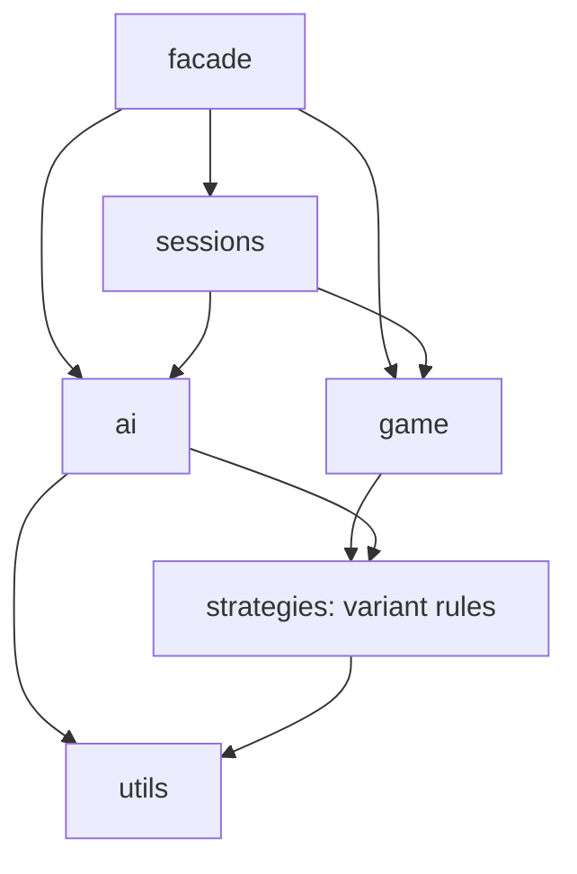
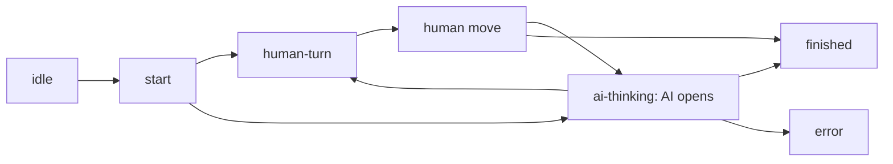

# Architecture

`t3core` is a framework-independent TypeScript library for Tic Tac Toe. It
provides game rules and history, AI move selection, session orchestration,
and a typed facade. React integration lives in the [README](README.md);
the runtime library has no React dependency.

## Public API and internal modules

The public API is the set of values and types re-exported by
[`src/index.ts`](src/index.ts). Consumers import from `t3core`.
[`package.json`](package.json) exposes the package root and `t3core/package.json`;
source paths and internal barrels are not supported package subpaths.
An `export` inside an implementation file does not by itself make a symbol
public to npm consumers.

The [v2 contract review](docs/v2-contracts.md) distinguishes implemented session
state from the remaining draft lifecycle contracts. The [migration notes](docs/v2-migration.md)
describe breaking observation changes. The descriptions below cover the current
working branch; the package version is unchanged.

| Module | Responsibility | Boundary |
| --- | --- | --- |
| [`game`](src/game/Game.ts) | Owns board state, player turns, status, history, and synchronous state notifications. | `Game` and selected contracts are public; the `Board` implementation is internal. |
| [`strategies`](src/strategies/strategies.types.ts) | Defines variant rules: board size and winner detection. | `GameStrategy` and variant resolution are internal. Currently only classic 3×3 is supported. |
| [`ai`](src/ai/types.ts) | Chooses a move from a board snapshot and context. Includes alpha-beta, random selection, and seeded RNG. | Public strategies implement `MoveStrategy`; search helpers and RNG internals stay behind the package entry. |
| [`sessions`](src/sessions/BaseSession.ts) | Coordinates `Game`, human input, AI, lifecycle, events, and stale operations. | `PvPGame`, `SinglePlayerGame`, `AIGame`, and selected contracts are public; `BaseSession` is internal. |
| [`facade`](src/facade/TicTacToe.ts) | Constructs a game, strategies, and a session for the chosen mode; delegates state observation. | `TicTacToe` exposes mode-specific instance types. `TicTacToeImpl` is internal. |
| [`utils`](src/utils/getWinnerFromFields.ts), [`constants`](src/constants/gameConstants.ts) | Shared winner detection and default symbols. | Only explicit root re-exports are public. |

## Dependency direction

The main implementation dependencies are shown below. Shared contracts and
defaults are omitted; AI reads game types without owning or mutating a `Game`.

Keep orchestration in sessions and construction in the facade. The game
layer must remain usable without AI or sessions. AI strategies receive
read-only data rather than a mutable game or a UI callback. Variant rules
must stay independent of session lifecycle. Shared contracts live with
their owning module; avoid importing the public root barrel back into
implementation modules and introducing dependency cycles.

`GameStrategy` answers which board positions win. `MoveStrategy` answers
which move an AI should play. Adding a board variant requires updating the
game variant registry and its tests; alpha-beta currently validates a
nine-cell board and cannot automatically support another variant.

## State, snapshots, and history

[`Board`](src/game/Board.ts) owns mutable storage. Empty fields contain
numeric labels; occupied fields contain string player symbols. Operations
use zero-based indices. The default symbols are `O` and `X`, with `O` starting.

The exposed `BoardSnapshot` is a cached, shallow-frozen copy. Repeated reads
return the same array until a board mutation, history restore, or reset.
Writing a field records a new history array. `backToMove(index)` restores
an existing history entry; making a subsequent move truncates its future.
`movesCount` counts recorded moves, so restoring history alone does not
truncate that count.

`Game.snapshot` caches `{ board, currentPlayer, gameStatus }`. Its reference
remains stable between accepted state operations and changes after a
successful `savePlayerMove`, successful `backToMove`, or `reset`. Rejected
moves do not replace it. Only its board array is frozen at runtime; treat the
surrounding snapshot and status objects as read-only too.

Sessions own a separate [SessionStore](src/sessions/state/SessionStore.ts).
`snapshot` and stable bound `getSnapshot()` return the same full session state:
board, resolved variant, mode, human symbol, current player, result, phase,
input availability, legal moves, current move count, undo availability and error.
The entire snapshot, including nested arrays and metadata, is frozen.
Repeated reads reuse its reference. A phase-only change reuses the board and
legal-moves array. Session `movesCount` counts occupied fields in the current
position; it does not count retained future history.

The store attaches no listeners to Game. Sessions commit state after their
domain mutations and Game callbacks return. Direct constructors accept a
pre-populated Game, but subsequent mutations must go through the session.
External writes to an injected Game bypass coherent session observation.

Board accessors throw `RangeError` for invalid indices. `Game.savePlayerMove`
and `Game.backToMove` instead return their documented status values for
invalid input. `Game.isFieldSelectedByIndex` delegates to the board and can
throw. Keep these contracts distinct when changing validation.

## Notifications and event ordering

There are three notification surfaces:

| Surface | Payload | When it notifies |
| --- | --- | --- |
| `Game.on(GameEvent.STATE_CHANGE, handler)` | `GameEventPayload`: `{ board, currentPlayer, gameStatus }` | Synchronously after an accepted move, history restore, or reset has updated the snapshot. |
| Session/facade `subscribe(callback)` | No arguments; read `getSnapshot()` in the callback. | After session moves, phase changes, errors and reset, in every mode. |
| Session/facade `on(event, handler)` | Typed gameplay payload from `GameSessionEventPayload`. | During session operations, as described below. |

`subscribe` and `getSnapshot` are stable, bound functions. Registration does not
notify immediately. A phase change can notify without changing the board.
Each subscription has its own idempotent cleanup, even when the same callback is registered
twice. For `on`/`off`, remove a listener with the same handler reference.

Session events carry these payloads, without a `type` field:

| Event | Payload | Meaning |
| --- | --- | --- |
| `move` | `{ player, position }` | A move has been applied. |
| `turn` | `{ player }` | Control passes to the next player; human-driven `start()` also announces the opening human turn. |
| `ai-thinking` | `{ player }` | An AI calculation is about to start. |
| `finished` | `{ result }` | The session reached a win or draw. |

When callbacks do not invalidate the operation or throw, an accepted move updates
Game and emits `STATE_CHANGE`. The session then commits its full snapshot and
notifies session/facade subscribers before emitting `move`. A terminal move
is followed by `finished`.
A nonterminal PvP or AI move is followed by `turn`. A nonterminal human move
in single-player instead starts `ai-thinking` and the AI calculation; the
AI's reply then emits its own `move` and `turn` or `finished`. Subscribers
observe both board snapshots separately. If the human ends the game, there
is no AI reply.

An opening AI turn publishes `ai-thinking` before its event and calculation.
A human move commits the board together with `ai-thinking`; the reply commits
`human-turn` or `finished`. AI-vs-AI `step` commits `ai-ready` after a nonterminal
move, while `run` stays in `ai-thinking` between moves. The terminal snapshot
is published once. Reads and rejected/busy actions do not notify.

The diagram shows single-player; reset returns every mode to idle.
The current runtime can also publish `paused` if an application callback
interrupts an AI turn, so the UI does not keep displaying active calculation.

Callbacks run synchronously at each emission. Listener exceptions propagate;
they do not roll back an already applied move. A callback can also call
`reset()` or start another operation from a ready-state callback, so session code
checks generation and operation identity after callbacks and awaited work.
A nested publication supersedes the remaining old notification delivery.
Reset notifies state subscribers but does not itself
emit a session `turn` or `finished` event.

## Lifecycle, concurrency, and cancellation

Construction performs no moves and emits no opening events. Register
listeners before starting a session.

| Mode | Entry points | After reset |
| --- | --- | --- |
| `pvp` | `start()`, then `playMove(index)` | Call `start()` again. |
| `singleplayer` | `start()`, then `playMove(index)`; `start()` applies an AI opening when the human plays second. | Call `start()` again. |
| `aivsai` | `step()` for one move or `run()` to completion; these start the session themselves. | Use `step()` or `run()` again. |

[`BaseSession`](src/sessions/BaseSession.ts) owns the lifecycle
(`idle`, `started`, `finished`, `error`), a generation counter, and an operation
lock. The public snapshot phase is more precise than this internal lifecycle.
Overlapping operations return `busy`. Calling `start()` while already
started throws. `reset()` returns the session to `idle`, resets the game,
increments the generation, and releases the lock for new work.

Every asynchronous operation captures its generation. If reset invalidates
it, a late strategy result or rejection is discarded and the operation
reports `aborted`. Check the generation before validating or applying a
returned move, and after callbacks that may reset the session. An old
operation's `finally` must release only its own lock by identity. Before
publishing a ready state, the session releases the completed operation's lock
so `canPlay` accurately reflects availability, including reentrant callbacks.
A newer operation supersedes the old continuation even within one generation.

Cancellation prevents stale work from changing state. The strategy contract
has no `AbortSignal`, so reset does not interrupt a running calculation or
stop external worker/network work initiated by a custom strategy. A custom
strategy must manage those resources itself. Current strategy errors publish
a serializable error snapshot and then propagate. Application callback exceptions
propagate without being classified as AI failures; applied moves are not rolled
back. An interrupted operation refreshes its position in a paused/terminal state
when necessary. Full stop/undo/dispose and normalized action results are stage 3.

## AI strategy contract

[`MoveStrategy.calculateMove`](src/ai/types.ts) receives a `BoardSnapshot`
and `MoveContext` (`aiSymbol`, `opponentSymbol`, `gameStatus`) and returns
`Promise<number>` with a legal empty field's zero-based index. Strategies
must preserve their input board. Built-in alpha-beta searches a private copy
and restores simulated moves while searching.

Built-in strategies reject with `MoveStrategyError("no_legal_moves", ...)`
when no empty field exists. Sessions validate returned indices and throw
`MoveStrategyError("illegal_move", ...)` for an invalid result. A strategy
error while a current session is running is not converted into a successful
finish. Custom strategies can be supplied to session constructors; the
`TicTacToe` facade configures the built-in engines.

Seeded strategy instances keep an RNG sequence across calculations. A
session reset does not recreate its strategies or rewind their RNGs;
recreate them (or the facade) to replay the original sequence. The stateless
`getBestMove` helper instead creates an RNG on each call. It returns an
`AIMoveResult` status and never applies the chosen move itself.

## Build and verification boundaries

[`tsup.config.ts`](tsup.config.ts) bundles the public entry into CommonJS
and ESM with matching declarations. Package `exports` selects the right
format. Generated `dist` files are build output; edit sources instead.
`prepack` builds before npm packaging or publication.

Tests under [`src/tests`](src/tests) cover game, AI, session, facade, and
public API behavior. [`scripts/check-package.mjs`](scripts/check-package.mjs)
installs an npm tarball into temporary consumers to check module resolution,
declarations, rejected invalid calls, and runtime behavior. Release tests
under [`scripts`](scripts/release.test.mjs) use temporary Git repositories.
[`Hook integration tests`](scripts/hooks.test.mjs) install Lefthook in
temporary repositories and check real Git commits. Local hooks lint staged
paths and validate commit messages; CI retains the full checks and validates
Conventional Commit PR titles. See the
[local Git checks](CONTRIBUTING.md#local-git-checks-and-commit-messages) guide.

See [CONTRIBUTING.md](CONTRIBUTING.md) for environment setup, quality checks,
and the API change checklist. See [Publishing to npm](.github/PUBLISHING.md)
for release and publication mechanics.
